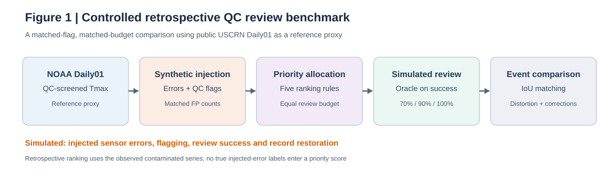
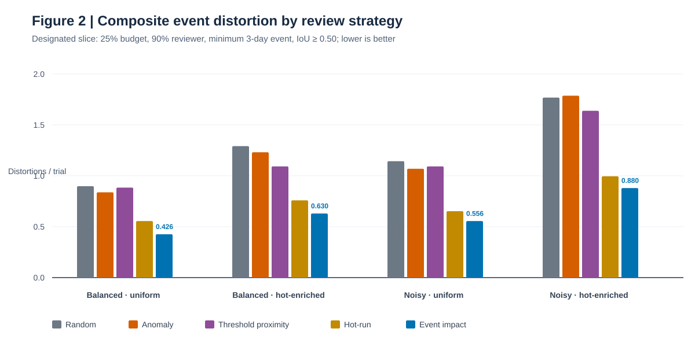
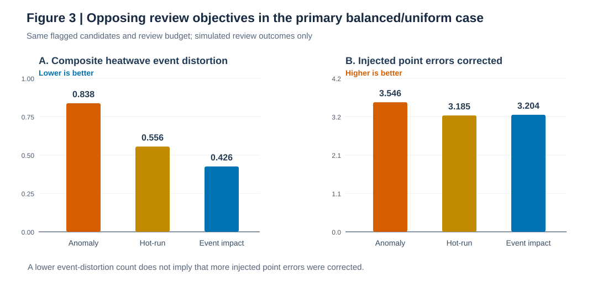
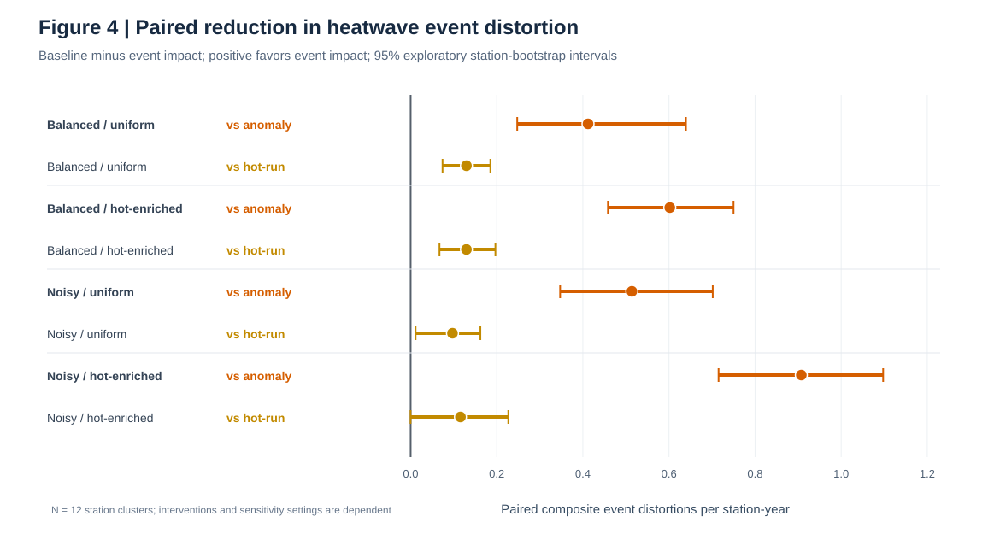

# Retrospective Heatwave-Aware Prioritization of Quality-Control Reviews: A Controlled Sensitivity Study Using Public Temperature Observations

**Manuscript draft v1.0 — 26 November 2026**  
**Status:** complete exploratory research draft for scientific review; **not yet approved for preprint submission**  
**Authors:** [Full author names and approved affiliations to be supplied]  
**Corresponding author:** [To be supplied]

> **Interpretation note.** The observational input is provider-quality-screened NOAA USCRN Daily01 temperature. All error injections, candidate QC flags and reviewer actions are simulated. Results describe the behavior of decision rules in this controlled offline benchmark, not the observed performance of NOAA QC or actual human reviewers. The 2023–2025 evaluation period informed iterative development and is not a prospectively untouched confirmatory holdout.

## Abstract

Quality-control (QC) flags identify observations that may require inspection, yet limited review capacity creates a second decision problem: which flagged records should be examined first? Ranking by the magnitude of a local temperature anomaly can favor detection of individual errors without explicitly preserving the continuity of heatwave episodes. We evaluated five retrospective review-prioritization heuristics—random selection, local anomaly, threshold proximity, observed hot-run length, and counterfactual event impact—at matched review budgets in controlled experiments based on public NOAA United States Climate Reference Network (USCRN) Daily01 maximum temperatures. Twelve stations satisfying a warm-season completeness criterion contributed 36 station-years in an exploratory 2023–2025 evaluation. A training-period calendar-day 90th-percentile threshold defined 85 reference heatwave events lasting at least three days. Synthetic temperature errors, QC flags, and an idealized reviewer operating with 70%, 90%, or 100% success probabilities were imposed on the provider-screened series. Across 155,520 dependent evaluation rows, heatwave events were compared using one-to-one day-set intersection-over-union matching. In a designated balanced/uniform scenario with a 25% review budget, 90% simulated reviewer success, three-day minimum event length, and an intersection-over-union threshold of 0.50, mean composite event-distortion counts per simulated trial were 0.838 for anomaly, 0.556 for hot-run, and 0.426 for event-impact prioritization. The paired event-impact reduction relative to anomaly was 0.412 distortions per station-year (exploratory 95% station-bootstrap interval: 0.248–0.639). However, anomaly prioritization corrected more injected point errors than event impact (3.546 versus 3.204 per trial). Findings were conditional on simulation assumptions, with stronger sensitivity of comparisons against hot-run. The experiment illustrates that prioritizing point-error correction and prioritizing heatwave-event continuity need not yield the same review order; it does not establish real-world QC superiority or a new general counterfactual-ranking principle.

**Keywords:** heatwaves; quality control; temperature observations; human-in-the-loop review; event-level evaluation; sensitivity analysis; counterfactual prioritization; USCRN

## 1 Introduction

Meteorological observation quality control supports climate analysis, environmental monitoring, and downstream decisions. Outlying measurements can arise from instrumental problems, transmission faults, or data-processing inconsistencies, but unusual temperature observations can also be genuine extremes. A QC flag is therefore a request for scrutiny rather than definitive evidence that a record is wrong. This distinction becomes especially consequential when analysts compute extremes from consecutive daily observations: handling or restoring one flagged day can alter whether a heatwave is detected, shortened, split, or missed.

Recent work has highlighted the need to preserve credible extreme-heat information during QC. Azargoshasbi et al. (2025) developed a heatwave-sensitive approach for crowdsourced monitoring, while Amini et al. (2026) demonstrated the importance of quality screening and metadata for heterogeneous urban temperature records. Spohn et al. (2026) examined autoencoder-based meteorological anomaly detection. These contributions focus mainly on detecting, evaluating, or retaining measurements; they do not by themselves answer how to allocate a *fixed number of reviews* among an already flagged set when the downstream outcome of interest is heatwave continuity. Meanwhile, Li et al. (2025) applied active learning to reduce human labeling burden in ocean data quality assessment, establishing that constrained review allocation is not unique to meteorology.

Event-level evaluation and counterfactual analysis are also established concepts. Zhong et al. (2026) studied event-level metrics and counterfactual explanation in multivariate time-series anomaly detection, including the computational cost of offline repair-oriented analysis. More broadly, the quality of meteorological corrections can matter for derived products (Dunkerly et al., 2026). Accordingly, this study does **not** claim to introduce event-aware QC, limited-budget review, or counterfactual prioritization in general. Instead, it examines a narrower application-specific question: in a controlled, equal-budget retrospective experiment, does ranking flagged daily maximum temperatures by their estimated contribution to heatwave structure reduce simulated event-level distortion relative to simple, label-blind heuristics?

The distinction between *which measurement is most suspicious* and *which measurement matters most to an event definition* motivates this benchmark. A large isolated anomaly can be an attractive review target, yet a moderately unusual observation located within a three-day heatwave may disproportionately determine whether the episode survives a missing-data rule. Conversely, protecting a hot sequence may divert review effort from genuinely erroneous records elsewhere. Both objectives are legitimate; they need not be equivalent.

We address four questions: (RQ1) How do five review rankings compare in simulated heatwave-event distortion at identical flagged records and inspection budgets? (RQ2) How sensitive are the differences to false-positive flag placement, reviewer reliability, review budget, event duration, and event-matching strictness? (RQ3) What is the relationship between event preservation and correction of injected point errors? (RQ4) Which design assumptions prevent extrapolation to operational QC systems?

The work is an **exploratory controlled sensitivity study**. NOAA data provide an already-QC-screened reference proxy; error locations, QC flags and successful reviews are synthetic. The method is retrospective because its event-impact score examines complete event structure, including dates later than the reviewed record. These conditions permit internally paired comparisons but not estimates of actual sensor failure rates, real reviewer accuracy, or deployed QC gains.

## 2 Data and methods

### 2.1 Public temperature product and station selection

We used the NOAA National Centers for Environmental Information (NCEI) USCRN *Daily01* product, specifically daily maximum air temperature (T_DAILY_MAX, degrees Celsius), indexed by the supplied station-local-standard-time date (LST_DATE) [1]. The downloaded product has already passed NOAA's provider-side processing and quality screening; it is not an archive of unmodified pre-QC raw sensor readings. We therefore use the term **reference proxy**, not verified ground truth.

A deterministic station-selection procedure considered station files appearing in both the 2010 and 2025 annual directories, with a fixed state-ordering rule. Candidate files were collected for 2010–2025, and each station was checked for the fraction of non-missing daily Tmax values during May–September separately in training, validation-reserved, and evaluation periods. Eligibility required at least 95% seasonal coverage in *every* period. The source audit contained 18 candidate stations; 16 met eligibility and 12 were retained by the deterministic selection rule. The 12 selected stations cover Arizona, Colorado, Florida, Georgia, Kansas, Missouri, Montana, North Carolina, New Mexico, New York, South Carolina, and Texas (Table 1). The minimum observed warm-season coverage across selected stations was 98.63% during training, 95.10% during the reserved validation interval, and 99.35% during evaluation.

The source manifest lists 288 downloaded annual station files, source URLs, and SHA-256 checksums. Missing-value codes (including the NOAA -9999.0 sentinel) were converted to missing. A complete calendar was reconstructed for each station, so dates absent from files were not silently treated as consecutive observations. No gap filling was applied. We retained station-local calendar dates rather than aligning days to UTC, which would change the definition of daily episodes for some stations.

### 2.2 Time partition and reference heatwaves

Training observations covered 2010–2020. The 2021–2022 data were reserved but were not used to select hyperparameters for the reported method. Events were evaluated during 2023–2025. Crucially, those latter years were reused while the broader project evolved from v1 through v2.1; they are therefore **an exploratory evaluation sample rather than an untouched independent holdout**.

For each station s and calendar day d, we estimated a temperature threshold Q(s,d) as the empirical 90th percentile of training Tmax values occurring within ±7 calendar days of d, with circular year-end handling. Leap day was excluded during threshold fitting. A day was classified as hot if its finite daily Tmax exceeded, strictly, the corresponding Q(s,d). Reference heatwaves comprised runs of at least L=3 consecutive hot days during May–September; L=6 was an alternative definition. Missing observations and non-hot days interrupted runs. Thresholds were held fixed across intervention and review policies, and were estimated exclusively from 2010–2020 data.

Reference events were detected on the provider-screened series *before* synthetic errors were injected. Among 36 evaluation station-years, we identified 85 reference events with L≥3 and 23 with L≥6; 32 and 16 station-years, respectively, contained at least one event under these definitions. These events are algorithmically defined episodes in the QC-screened reference, not independently adjudicated true heatwaves.

### 2.3 Error injection and synthetic candidate flags

Each station-year entered six simulation repetitions under two nominal synthetic flag-generator regimes (balanced and noisy). In each repetition, controlled positive and negative temperature perturbations were injected into a copy of the reference series. Perturbations included isolated values and short contiguous offsets on warm-season hot and non-hot dates, with magnitudes selected from 4, 6 and 9 °C. A typical trial contained approximately 10.7 injected-error dates out of 153 May–September days (about 7%). This prevalence was deliberately constructed for stress testing and is **not an estimate of genuine USCRN failures**.

The simulated QC flag generator had nominal true-positive rates of 0.85 (balanced) and 0.65 (noisy), and selected false-positive flags at fractions of 0.04 and 0.09, respectively, of eligible non-error days. These parameters are model settings, not calibrated operational detection rates. The flag mechanism is informed by injected-error labels; by contrast, the priority strategies evaluated downstream cannot access those labels.

Two false-positive placement mechanisms were compared. In the *uniform* condition, false flags were sampled uniformly from eligible error-free warm-season days. In the *hot-enriched* condition, an observation above the training-defined heat threshold received six times the relative sampling weight when false flags were allocated. For each corrupted series, the number of false-positive flags and the true-positive flag mask were held **identical** between placement conditions. Thus, differences isolate flag placement rather than flag quantity; the intended enrichment is probabilistic, not a fixed number of hot-day flags.

### 2.4 Retrospective review prioritization

All five strategies received the same corrupted Tmax series, simulated flag mask, and threshold estimates. Only flagged observations were eligible for inspection. The review budget was 10%, 25%, or 50% of flagged records, rounded upward to an integer, and was identical across strategies within every paired trial.

The strategies were:

1. **Random:** a reproducibly seeded permutation of flagged candidates.
2. **Local anomaly:** absolute deviation between the candidate's contaminated Tmax and the median of up to three observed neighboring days on either side, excluding the candidate itself.
3. **Threshold proximity:** an inverse distance score, 1/(1 + |Tmax − Q|), favoring flagged readings near the training-defined hot-day boundary.
4. **Hot-run length:** the length of the observed contiguous above-threshold spell containing the candidate; candidates outside hot spells receive zero.
5. **Event impact:** a leave-one-flagged-day-out sensitivity score computed on the *contaminated observed series*. For each candidate, its Tmax is temporarily replaced by missing, heatwaves are recomputed, and the absolute changes in event count, total event-days, and longest event duration are combined, with a small near-hot-day context term and minimal anomaly tie-break. The implemented core score is 3|ΔN_events| + |ΔD_event_days| + 0.5|ΔL_longest|, before tie-breaking terms.

These heuristics use only available contaminated readings, known synthetic flags and train-fitted thresholds, never injected-error labels or the uncorrupted reference when computing their rankings. The event-impact heuristic examines the complete station-year series and is thus **retrospective/offline**, not an available causal real-time score. Its focus on event topology is deliberately aligned with the event-level evaluation objective, a structural advantage discussed below.

### 2.5 Simulated reviewer and resulting temperature series

For each flagged candidate the experiment generated a fixed uniform random draw that was reused across ranking methods and success settings. A reviewed record was treated as successfully resolved when its draw was below the chosen simulated success probability of 0.70, 0.90, or 1.00. Upon success, the record's temperature was restored **exactly** to the original provider-screened reference; upon failure, its flagged temperature remained missing. All unreviewed flagged observations were also treated as missing, while unflagged injected errors remained in the record.

This reviewer is an **optimistic oracle-on-success intervention**: even a false flag is restored to its reference value, and a genuine injected error is corrected without residual measurement error when a review succeeds. Real inspectors can disagree, miss faults, or issue imperfect corrections; those possibilities are not modeled. Holding per-day draws fixed makes reliability scenarios nested and facilitates paired comparisons, but it does not transform simulated probabilities into empirical human-review accuracies.

### 2.6 Event matching and outcomes

After each review policy, heatwaves were reconstructed using the fixed station threshold and the same L-day definition. Candidate and reference events were matched *one-to-one* by an assignment maximizing their day-set intersection-over-union (IoU), retaining matched pairs only when IoU met the specified minimum of 0.25 or 0.50. The assignment was solved globally with the Hungarian algorithm.

The designated composite distortion count for a trial was

**D = N_missed reference events + N_unmatched candidate events + N_fragmented reference events.**

A missed event is a reference event with no accepted one-to-one match; an unmatched candidate is a detected event without an accepted reference match. Fragmentation is assessed separately through multiple overlapping candidate runs derived from one reference run. The three components can overlap conceptually; D is therefore an *ad hoc, equally weighted decision-specific measure*, not a universal climatic loss function. In particular, the matching constraint can penalize splits while fragmentation also contributes to D. We consequently report individual components alongside D.

Additional outcomes included reference hot days missing from all post-review detected events, extra detected hot days, merged events, the number of corrected injected point errors, and absolute differences in duration and peak Tmax for *matched events only*. Because matching determines which peak errors are observed, a comparison of matched-event peak error is subject to selection effects and is not a whole-sample accuracy estimate.

### 2.7 Paired design, uncertainty and sensitivity

The factorial experiment varied two flag-generator regimes, two false-positive placements, two event-duration thresholds, three review budgets, three simulated reviewer success probabilities, two IoU cutoffs, and five strategies. Six corrupted-series repetitions were generated for each of 36 station-years and two detector regimes. This produced **432** corrupted station-year/regime/repetition series, **864** flag-mask groups, and **155,520** strategy/evaluation rows. These rows are **not independent observations**: multiple configurations reuse the same temperatures, error masks, flags, and reviewer draws, and each post-review event set is evaluated at two IoU thresholds.

Policy effects were computed within matched trials as the outcome under a baseline heuristic minus the outcome under event impact, then averaged within station-years. For loss outcomes, a positive effect means fewer losses under event impact. For **number of corrected errors**, the same numerical subtraction has the opposite desirability: a positive baseline-minus-event-impact difference means that *event impact corrected fewer errors*. We used station-level cluster bootstrap resampling (300 draws) to obtain exploratory percentile intervals from 12 station clusters, retaining station-year average differences as the target estimate. Intervals should not be treated as confirmatory p-values; stations may share spatial climate dependence, and numerous non-independent sensitivity comparisons were examined.

Within v2.1, the **designated primary analysis slice** uses L≥3 days, IoU≥0.50, 25% review budget and 90% reviewer success, reporting both synthetic flag regimes and both false-positive placements. This slice was designated during development, **not prospectively preregistered before all evaluation outcomes were inspected**. Comparisons with anomaly and hot-run are emphasized; other heuristics provide context.

## 3 Results

### 3.1 Dataset coverage and simulation integrity

All 288 source-manifest entries were recorded as downloaded. The 18 candidate-station coverage audit yielded 16 eligible stations; the deterministic selection procedure retained 12. Each selected station contributed three evaluation years, or 36 station-years total. Selected-station warm-season completeness was high overall; the minimum across sites and periods was 95.10%. Reference events were geographically and temporally heterogeneous: 85 met the three-day threshold, but only 23 met the six-day threshold. Four station-years had no three-day event, and 20 had no six-day event; such station-years remain in the *all station-years* comparison.

Quality checks on the archived simulation outputs identified no duplicate trial row keys. Within paired strategy groups, the flagged observation counts and inspection budgets matched. The composite outcome equaled the recorded sum of its three components in every trial row. Matched false-positive counts and identical true-positive masks between uniform and hot-enriched scenarios were confirmed in the previously archived audit. There were 155,520 downstream rows but only 12 station clusters for the exploratory uncertainty calculation.

**Table 1. NOAA sample and controlled-experiment design.** Counts refer to the v2.1 experiment; reference-event counts are not actual operational NOAA QC outcomes.

| Quantity | Audited value |
| --- | ---: |
| Candidate stations / eligible stations / selected stations | 18 / 16 / 12 |
| Station-years, 2023–2025 | 36 |
| Downloaded station-year source files, 2010–2025 | 288 |
| Minimum selected-station train / reserved validation / evaluation coverage | 98.63% / 95.10% / 99.35% |
| Reference heatwaves with at least 3 / 6 days | 85 / 23 |
| Station-years with at least one 3-day / 6-day reference event | 32 / 16 |
| Corrupted-series draws / flag-mask groups | 432 / 864 |
| Simulation repetitions per station-year and detector regime | 6 |
| Strategy/evaluation rows (dependent) | 155,520 |
| Uncertainty clusters | 12 stations |

### 3.2 Comparison among review-ranking heuristics

Table 2 shows composite event distortion for the designated primary slice. Under the balanced/uniform flag scenario, mean distortion per trial was 0.898 for random, 0.838 for anomaly, 0.884 for threshold proximity, 0.556 for hot-run, and 0.426 for event impact. Both event-structured strategies outperformed the two single-point-oriented deterministic heuristics for this simulated outcome; event impact also showed a smaller distortion count than hot-run.

The ordering persisted descriptively across the noisy and hot-enriched settings, although absolute distortions changed considerably with the flag mechanism. For example, under noisy/hot-enriched false flags, anomaly yielded 1.787 distortions per trial, hot-run 0.995, and event impact 0.880. False-flag placement thus materially affected the difficulty of reconstructing heatwaves when unreviewed flagged days were treated as missing.

**Table 2. Mean composite event distortion per simulated trial in the primary analysis slice (lower is better).** L≥3, IoU≥0.50, 25% review budget and simulated reviewer success probability 0.90; 216 trials contribute to each displayed regime/placement/strategy cell.

| Strategy | Balanced/uniform | Balanced/hot-enriched | Noisy/uniform | Noisy/hot-enriched |
| --- | ---: | ---: | ---: | ---: |
| Random | 0.898 | 1.292 | 1.144 | 1.769 |
| Local anomaly | 0.838 | 1.231 | 1.069 | 1.787 |
| Threshold proximity | 0.884 | 1.093 | 1.093 | 1.639 |
| Hot-run length | 0.556 | 0.759 | 0.653 | 0.995 |
| **Event impact** | **0.426** | **0.630** | **0.556** | **0.880** |

**Figure 1.** Controlled retrospective review benchmark, from quality-screened NOAA reference temperatures to synthetic errors and flags, five budget-matched rankings, idealized review, reconstructed heatwaves and paired outcome comparison. Every simulation-specific step should be labeled as synthetic or idealized. Vector SVG supplied; replace or refine for publisher specifications if needed.

### 3.3 Paired differences and exploratory uncertainty

Pairing on identical corrupted series and budgets yielded positive event-impact gains relative to anomaly in all four primary flag-setting combinations (Table 3). Under balanced/uniform flags, the reduction was **0.412 simulated composite distortions per station-year**, with an exploratory 95% station-bootstrap interval of **[0.248, 0.639]**. The comparison against hot-run was smaller, **0.130 [0.074, 0.185]**. Under noisy/uniform flags, corresponding gains were **0.514 [0.347, 0.702]** and **0.097 [0.012, 0.162]**.

Event impact retained a descriptive advantage over hot-run when flags were concentrated on hot days, but its robustness was weaker in the noisy/hot-enriched condition: the paired gain was 0.116 with interval **[-0.0002, 0.227]**. The interval includes zero to the reported precision. Thus the stronger conclusion concerns comparison with anomaly; superiority to a simpler event-aware hot-run heuristic is less stable.

**Table 3. Paired reduction in composite event distortion (baseline minus event impact), per station-year.** Positive favors event impact; 95% exploratory percentile intervals are from 300 station-cluster bootstrap resamples across 12 stations.

| Synthetic regime / FP placement | vs anomaly, gain [95% interval] | vs hot-run, gain [95% interval] |
| --- | --- | --- |
| Balanced / uniform | 0.412 [0.248, 0.639] | 0.130 [0.074, 0.185] |
| Balanced / hot-enriched | 0.602 [0.458, 0.750] | 0.130 [0.067, 0.197] |
| Noisy / uniform | 0.514 [0.347, 0.702] | 0.097 [0.012, 0.162] |
| Noisy / hot-enriched | 0.907 [0.715, 1.098] | 0.116 [-0.0002, 0.227] |

The full 144-setting sensitivity grid (2 regimes × 2 placements × 2 lengths × 3 budgets × 3 reviewer probabilities × 2 IoU values) had a positive event-impact-minus-anomaly *loss reduction* in all 144 cells. Relative to hot-run, 142 cells favored event impact descriptively, one was tied, and one favored hot-run. These counts are a **descriptive robustness inventory, not 144 independent validation experiments**; they should not be used as familywise statistical evidence.

**Figure 2a.** Composite event distortion across the five ranking strategies in the designated primary analysis slice, based on the archived NOAA v2.1 controlled-experiment CSV. Descriptive bars are mean counts per simulated trial.

**Figure 2.** Paired gains from event impact relative to anomaly and hot-run under the four synthetic flag settings, using the designated primary slice. Intervals are exploratory station-level percentile bootstrap ranges. The displayed figure is a strategy-level descriptive companion; Figure 4 presents the paired bootstrap intervals directly from v21_paired_effects.csv.

### 3.4 Distortion components and correction trade-offs

The observed composite difference reflected primarily fewer missed reference events, although individual components did not all improve reliably. Under balanced/uniform flags, anomaly produced means of 0.634 missed events, 0.144 unmatched candidate events, and 0.060 fragmented reference events per trial; event impact produced corresponding means of 0.319, 0.079, and 0.028. Event impact also reduced missed reference hot days, from 3.005 to 1.602 per trial. The paired reduction in missed events was **0.315 [0.236, 0.405]**, and the reduction in missed reference hot days was **1.403 [1.088, 1.720]**, both on the station-year pairing scale. The unmatched-event paired interval crossed zero, indicating a less clear advantage for that component.

However, event impact did **not** optimize correction of point-level injected errors. In the same balanced/uniform primary slice, the anomaly heuristic corrected **3.546** injected errors per trial, compared with **3.204** for event impact; the paired anomaly-minus-event-impact correction difference was **0.343 [0.190, 0.477]**. In the noisy/hot-enriched scenario the gap widened (3.875 anomaly versus 2.556 event impact). The event-impact heuristic also did not have a lower observed mean absolute peak-temperature error *conditional on having a matched event*: 0.411 °C for event impact compared with 0.371 °C for anomaly in balanced/uniform conditions. Because the strategies matched different numbers of events, this conditional peak comparison must not be taken as direct proof of inferior or superior temperature estimation.

**Table 4. Outcome components in the balanced/uniform primary slice.** Means per simulated trial. A lower count is desirable for all rows except injected errors corrected, for which higher is desirable.

| Outcome | Anomaly | Hot-run | Event impact |
| --- | ---: | ---: | ---: |
| Composite distortion | 0.838 | 0.556 | 0.426 |
| Missed reference events | 0.634 | 0.440 | 0.319 |
| Unmatched candidate events | 0.144 | 0.083 | 0.079 |
| Fragmented reference events | 0.060 | 0.032 | 0.028 |
| Missing reference hot days | 3.005 | 1.958 | 1.602 |
| Extra candidate hot days | 0.083 | 0.111 | 0.111 |
| **Injected point errors corrected** | **3.546** | 3.185 | 3.204 |
| Matched-event conditional mean absolute peak error (°C) | 0.371 | 0.411 | 0.411 |

**Figure 3.** In the balanced/uniform primary setting, plot composite event distortion together with corrected injected point errors on separate labeled panels; the opposite preferred directions of the two metrics demonstrate the decision trade-off. Descriptive means were calculated from v21_trials.csv; uncertainty for the paired station-year comparisons is reported in the accompanying tables.

### 3.5 Budget, reviewer, and duration sensitivity

At 90% simulated reviewer success in balanced/uniform conditions with L≥3 and IoU≥0.50, the event-impact gain versus anomaly varied from 0.250 [0.171, 0.331] at a 10% review budget to 0.412 [0.248, 0.639] at 25% and 0.310 [0.176, 0.463] at 50%. Against hot-run, the corresponding gains were 0.065, 0.130 and 0.167. Increasing budget therefore did not cause a monotonic increase in relative gain over anomaly in this stress test; it changed which flags remained unreviewed and the scope for event reconstruction.

At a 25% budget, changing simulated reviewer success from 70% to 90% to 100% changed the paired gain over anomaly from 0.296 to 0.412 to 0.435 under balanced/uniform flags. Restricting events to at least six hot days reduced the gain over anomaly to 0.162 [0.072, 0.296] and over hot-run to 0.056 [0.016, 0.097] for this same regime and review setting. Because only 16 of 36 station-years contained any six-day event, estimates for that definition reflect a sparser event landscape.

**Table 5. Selected sensitivity comparisons (balanced/uniform, L≥3, IoU≥0.50 unless stated).** Gains are reductions in composite distortions per station-year under event impact; intervals are exploratory.

| Review budget | Reviewer success | Minimum heatwave days | Gain vs anomaly [95% interval] | Gain vs hot-run [95% interval] |
| ---: | ---: | ---: | --- | --- |
| 10% | 90% | 3 | 0.250 [0.171, 0.331] | 0.065 [0.023, 0.127] |
| 25% | 70% | 3 | 0.296 [0.125, 0.519] | 0.069 [0.028, 0.116] |
| 25% | 90% | 3 | 0.412 [0.248, 0.639] | 0.130 [0.074, 0.185] |
| 25% | 100% | 3 | 0.435 [0.280, 0.627] | 0.157 [0.102, 0.234] |
| 50% | 90% | 3 | 0.310 [0.176, 0.463] | 0.167 [0.111, 0.236] |
| 25% | 90% | 6 | 0.162 [0.072, 0.296] | 0.056 [0.016, 0.097] |

**Figure 4.** Plot event-impact paired gains against budget and simulated reviewer success; show the balanced/uniform scenario with distinct anomaly and hot-run comparators, and distinguish event duration in an optional supplementary panel. The displayed interval plot is derived from the archived v21_paired_effects.csv; the eight plotted comparisons share station-years and are not independent replications.

## 4 Discussion

### 4.1 Event preservation is a different optimization target from anomaly correction

The most informative result is not simply that an event-aware score produced fewer events lost in its own evaluation target. Rather, the controlled comparison exposed an explicit **objective conflict**. A local anomaly score preferentially sends strongly deviant observations to review, thereby correcting more injected temperature errors in the primary balanced/uniform setting. The event-impact score directs attention toward flagged days with disproportionate influence on heatwave topology. Under the missing-if-unreviewed convention, this can preserve an episode even when the reviewed value is not among the largest point anomalies. Consequently, the ordering that maximizes corrected error counts need not minimize event loss.

This trade-off matters conceptually for downstream climate indices and monitoring products, where an individual record's contribution depends on temporal structure. Yet the benchmark alone cannot specify which objective should dominate an operational decision. Priorities would depend on the consequences of missed events, the cost of false events, reviewer effort, and the reliability of actual corrections.

### 4.2 The hot-run heuristic is a consequential comparator

Hot-run ranking yielded lower event distortion than anomaly ranking in each of the four designated primary settings and reduced the incremental margin available to event impact. Under balanced/uniform flags, event impact's paired gain over anomaly was 0.412 but only 0.130 over hot-run. The noisy/hot-enriched hot-run comparison had a bootstrap interval extending just below zero. This limits the claim of incremental benefit from the more complicated leave-one-out topology score. A simple ranking by observed hot-run length may capture a substantial portion of the useful event information with less computational effort.

The proposed score also shares mathematical structure with its evaluation objective: both depend on event topology. Such alignment is a design choice, not evidence of general algorithmic optimality. Zhong et al. (2026) already demonstrated event-level and counterfactual methods in a different time-series setting. The contribution here is limited to a specific **retrospective, budget-matched heatwave review trade-off**, not a novel general principle of counterfactual review.

### 4.3 Influence of flagging assumptions and idealized reviews

Concentrating false-positive flags on hot days raised distortions under most strategies because potentially event-defining days were disproportionately removed unless successfully reviewed. The matched flag counts and identical true-positive masks isolate placement effects within the simulated design; they do not establish the spatial or temporal distribution of false positives from actual operational QC.

Several assumptions favor clean interpretation but weaken practical realism. Error injection uses approximately 7% of warm-season dates per trial, much higher than any error frequency this study has independently established. The simulated generator knows the injected-error labels when constructing true-positive flags. The reviewer is an oracle upon success and never supplies an incorrect alternative temperature. Failed inspections merely leave values missing; incorrect reinstatements and uncertain adjudications are absent. These choices allow controlled contrasts but can substantially alter trade-offs relative to realistic workflows. Lower error-prevalence scenarios and independent expert-verified review outcomes are priorities for future validation, not prerequisites to interpreting this pilot as a simulation.

### 4.4 Reference validity and evaluation leakage

USCRN Daily01 is a scientifically useful public product, but it is provider quality-screened rather than a ground-truth archive of never-checked measurements. Restoring a simulated flag to its Daily01 reference cannot establish that an actual NOAA observation was correctly measured. Likewise, nominal detector true-positive rates, synthetic false-positive rates, and reviewer success probabilities cannot be described as measured properties of NOAA personnel, algorithms or instruments.

A second limitation is the reuse of 2023–2025 outcomes during method development. Although temperature thresholds came from the specified training period and the reviewer rankings themselves did not receive clean references, the evaluation period was visible during the progression from v1 to v2 and v2.1. The reported contrasts are therefore **hypothesis-generating**. They are not a prospectively preregistered, untouched test of a frozen method. Independent stations or an additional temporal replication would help determine whether the observed ranking persists without further score refinement.

### 4.5 Outcome construction, sensitivity and uncertainty

The equal-weight composite treats a missed event, an unmatched candidate and a fragmented event as numerically interchangeable. A single split can be reflected in both unmatched matching penalties and fragmentation, so composite magnitude should not be interpreted literally as a count of independent physical harms. Component-level results are necessary to understand the consequences of review choice. Additional event definitions, matching rules and multi-objective utility weights may lead to different rankings.

The study sampled only 12 stations, all in the contiguous United States, and the ≥6-day reference events were scarce. Station-level bootstrap intervals from 12 clusters do not fully address between-station geographic dependence, finite sample uncertainty, or the search over many related configurations. The 155,520 evaluated rows and 144 sensitivity settings are **not independent replications**. Furthermore, the event-impact ranking uses complete station-year information and cannot be deployed unchanged for streaming QC. Generalization to other climate regimes, humidity or precipitation variables, subdaily time scales, and deployed quality-control systems remains unknown.

### 4.6 Implications and next research steps

The study supports a limited methodological implication: the **target of review prioritization should be made explicit**, because pointwise anomaly correction and event continuity can conflict under a fixed inspection budget. Operational translation would first require a realistic error-labeling mechanism; transparent tracking of flags, decisions and original values; a feasible near-real-time approximation if streaming use is desired; and cost-sensitive evaluation with independently adjudicated cases.

A minimal next evaluation would fix the v2.1 score and test previously unused eligible stations or a separately designated period without modifying it on the basis of those outcomes. A second stress test would reduce injected-error prevalence, for example to hypothetical 1% and 3% levels, while separately varying error magnitude and review cost. More ambitious future work should incorporate genuinely observed QC decisions and independently verified labels. These extensions would test transferability rather than merely adding more dependent synthetic evaluation rows.

## 5 Conclusions

Using public, already-QC-screened USCRN daily maximum temperatures as a reference proxy, we compared five retrospective rules for allocating a fixed review budget among **synthetically** flagged observations. Under a designated balanced/uniform intervention, event-impact ranking produced fewer composite heatwave-event distortions than local anomaly and hot-run heuristics, with paired exploratory station-bootstrap intervals supporting the descriptive differences for that setting. Nevertheless, anomaly ranking corrected more injected individual point errors, and the incremental gain over the simpler hot-run baseline was less robust when flags were concentrated on hot days.

The central conclusion is therefore **conditional and decision-focused**: prioritizing individual temperature anomalies is not equivalent to prioritizing heatwave-event continuity in the tested simulated review framework. The findings do **not** quantify actual NOAA QC errors, human review accuracy, real-time feasibility, or universal superiority of an event-impact method. The benchmark is intended to motivate further independently validated and cost-aware examination of meteorological QC review priorities.

## Code availability

The source repository is [priambudihudaf/projects-heatwave-qc-policy-benchmark](https://github.com/priambudihudaf/projects-heatwave-qc-policy-benchmark). The v2.1 implementation uses run_v21.py, src/heatqc/review_v21.py, and shared helpers from src/heatqc/review_v2.py, src/heatqc/core.py, and src/heatqc/noaa.py. Manuscript inputs were obtained from the [successful v2.1 NOAA GitHub Actions run](https://github.com/priambudihudaf/projects-heatwave-qc-policy-benchmark/actions/runs/45758900953) (artifact name: v21-noaa-robustness-results). **Record the final immutable analysis commit, permanent artifact archive and software dependency snapshot before submission.** Manuscript-only changes to the repository after the run are not evidence of computational reruns.

## Data availability

Public NOAA USCRN Daily01 files are distributed by NCEI [1]. The archived source_manifest.csv records 288 download URLs and SHA-256 hashes for the source snapshot used in the controlled experiment; coverage_audit.csv records station eligibility. Simulated interventions and descriptive/paired outcomes are supplied in v21_trials.csv, v21_descriptive_summary.csv, v21_paired_effects.csv, and v21_metadata.json in the workflow artifact; **these are synthetic research outputs, not NOAA-released QC annotations**. Because GitHub Actions artifacts can expire, deposit the audited result archive and a checksum manifest in durable public storage before preprint submission. No restricted BMKG dataset is included in the experiment.

## Author contributions

[Complete only after authorship is agreed. Provide truthful conception, methodology, software, validation, analysis, writing and supervision contributions for each actual author.]

## Competing interests

[Each author must confirm the declaration before publication. No claim of absence is made on their behalf.]

## Funding

[Disclose actual funding, or confirm the absence of specific project funding after verification.]

## Acknowledgements and use of generative AI

Drafting, editing and organization of the manuscript, as well as discussion of computational analysis and the open-source code workflow, were assisted by OpenAI ChatGPT. Numerical findings were checked against the archived v2.1 CSV outputs, and official publication sources and recent comparator publications were reviewed during drafting. **Human authors remain responsible for verification of analyses, references, claims, originality and the submitted version.** Amend this statement to describe the actual tool use and final author-approved scope before submission.

## References

[1] NOAA National Centers for Environmental Information (NCEI). *U.S. Climate Reference Network (USCRN): Data products and Daily01 documentation*. https://www.ncei.noaa.gov/access/crn/products.html and https://www.ncei.noaa.gov/pub/data/uscrn/products/daily01/readme.txt (accessed 26 November 2026).

[2] Azargoshasbi, F., Vahmani, P., and Minet, L.: Leveraging Crowdsourced Data for Extreme Heat Monitoring, *International Journal of Climatology*, **45**, e70050, 2025. https://doi.org/10.1002/joc.70050.

[3] Li, N., Qi, Y., Xin, R., et al.: Leveraging active learning for ocean data quality assessment: reducing labeling workload and addressing severe data imbalance challenges, *International Journal of Data Science and Analytics*, **20**, 4777–4798, 2025. https://doi.org/10.1007/s41060-025-00751-w.

[4] Zhong, B., Li, J., Pu, Z., and Zhang, R.: A Practical Framework for Event-Level Evaluation and Verifiable Counterfactual Explanation in Multivariate Time-Series Anomaly Detection, *Applied Sciences*, **16**(11), 5450, 2026. https://doi.org/10.3390/app16115450.

[5] Spohn, T. K., Walsh, E., Horan, K., O'Donoghue, J., Charnecki, T., Haslam, M., and Gallagher, S.: A machine learning approach using autoencoders to perform quality control on meteorological data, *Environmental Data Science*, **5**, e1, 2026. https://doi.org/10.1017/eds.2026.10030.

[6] Amini, S., Huerta, A., Franke, J., et al.: Comprehensive compilation and quality assessment of street-level urban air temperature measurements across European networks, *Scientific Data*, **13**, 658, 2026. https://doi.org/10.1038/s41597-026-06804-4.

[7] Dunkerly, C., Volk, J. M., Majumdar, S., et al.: A Benchmark Dataset of Agricultural Weather Stations over the Contiguous United States for Evapotranspiration Applications, *Scientific Data*, **13**, 1182, 2026. https://doi.org/10.1038/s41597-026-07819-7.

---

## Editorial / scientific review notes — remove before submission

- This draft is complete as a narrative but **not submission-ready**: populate verified authors/affiliations/declarations, produce final camera-ready figures and supplementary tables, and archive outputs permanently.
- The full NOAA v2.1 results were directly re-read from the [GitHub Actions artifact](https://github.com/priambudihudaf/projects-heatwave-qc-policy-benchmark/actions/runs/45758900953). The old *v1 preserve/remove/cap* protocol and output were **not** used for numerical tables.
- If applying the EGUsphere standalone preprint route, use current page/line-numbered publication template, check the required AI disclosure, and obtain any necessary institutional or coauthor approvals.
- The evaluation period was used during method development; all claims must remain **exploratory**, and reported intervals must not be treated as confirmatory hypothesis tests.
- The **counterfactual score's structural alignment with event-level loss** is a central caveat; do not conceal it or claim the method is generally superior.
- Verify all bibliography details against final publisher records before posting; add foundational heatwave-definition literature as needed for journal scope.
